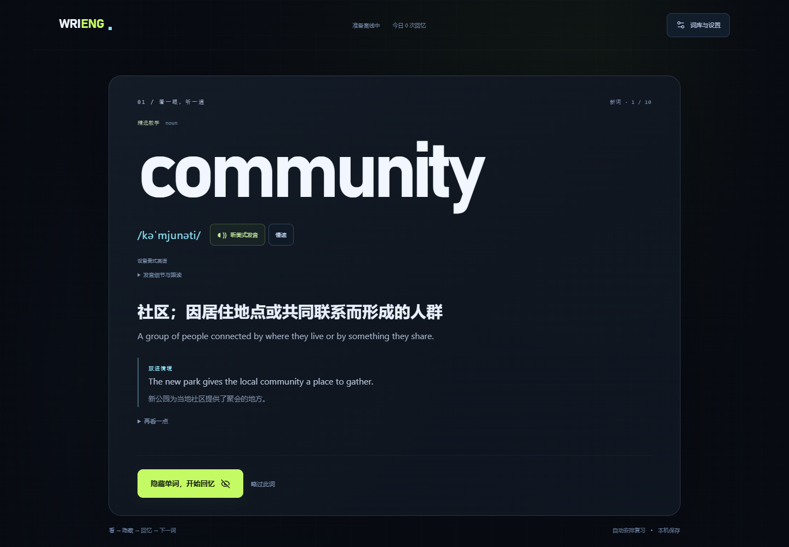
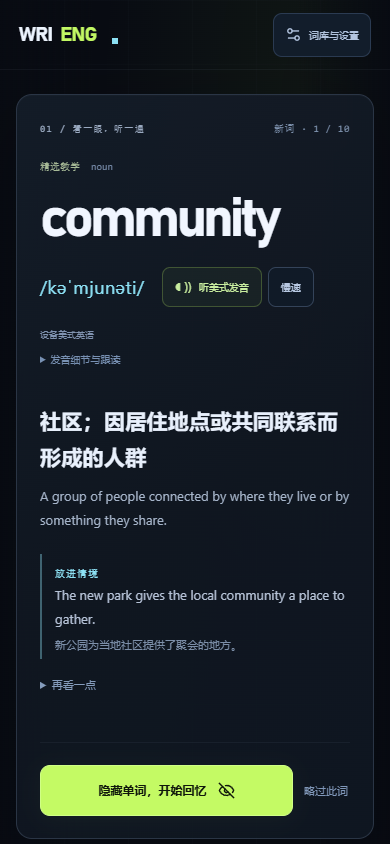

# WriEng v3 验收记录

2026-10-18。本轮验证对象为极简学词主流程与扩展词典底库；本机生产预览地址为 <http://127.0.0.1:4173/>。测试使用这台 Windows 电脑安装的 Chrome **155.0.8059.84**，运行在独立临时 Playwright 上下文，没有读取真实用户浏览器资料。

## 实际结果

- 类型检查、生产构建通过；本轮完整单元测试 **107/107** 通过。
- 生产浏览器验收 **8/8** 通过，耗时 **23.073 秒**；无跳过、意外失败或重试后通过。8 场景的未捕获页面错误、控制台错误与失败请求记录均为空。
- 学习库实际可用 **6,172 个词义**：172 个精选教学词义，加 6,000 个去重词典底库词头。新用户默认日常路线，实测首词为 `community`；已有范围设置保留。词库每页 40 条。
- 在这台测试电脑、6,172 词义库上，6 次真实筛选操作分别耗时 **44、39、29、28、51、45 毫秒**，包括无结果与恢复全部结果；这不是其他设备性能的保证。

| 浏览器场景 | 验证内容与结果 |
| --- | --- |
| 直接学习 | 首访直接显示大词头、自然/慢速发音按钮和隐藏按钮，无问卷入口；通过。 |
| 键入回忆 | 答案从可见文字及辅助标签移除；原始输入、提交时间在反馈刷新后不变，评级后产生单个事件；通过。 |
| 提示与错误 | 错误拼写与首字母提示后的正确拼写都不能保存独立 Good，只进入 Again；通过。 |
| 手写回忆 | 真正触摸笔划可提交，空白点击不可提交；原笔迹对照、自评和刷新后的有笔迹证据正常，图片不进入备份；通过。 |
| 跨日复习 | 完成 10 个新词后推进到真实 FSRS 到期时间，自动进入隐藏回忆；事件由 10 增至 11，覆盖 10 月 18 日与 20 日两个本地日期；通过。 |
| 大词库与排队 | 筛选、分页和长词 `interdisciplinary` 加入下一词不丢当前提交；320/390px 均无横向溢出；通过。 |
| 离线与备份 | 断网刷新和继续学习、导出、新上下文恢复、重复导入去重与损坏 JSON 拒绝；通过。 |
| 移动与辅助设置 | 桌面、平板、390/320px、720 CSS px × 2 倍像素密度等效重排、减少动态持久化；通过。等效重排不是浏览器菜单缩放实测。 |

原始生产测试证据保存在本机 `docs/test-results-v3/acceptance-summary.json` 与 `results.json`；这些日志及完整历史截图由 `.gitignore` 排除，未删除。

## 离线缓存

根路径缓存版本为 `87bf07a9ba40fec8d39d`，共 **21 项、4,967,549 字节**（约 4.967 MB）。额外 Chrome PWA 检查对 **21/21** 项缓存逐个校验哈希，并验证深路径离线导航、当前词键入提交与评级、此前未打开的 core 词 `interdisciplinary` 首次离线学习、再次刷新及记录保留；通过。该附加场景对 core 词验证到首次学习与刷新，未单独提交这个 core 词的回忆。原始结果为本机 `docs/test-results-v3/pwa-root.json`。

运行时词库已随 JavaScript 缓存。`data/core-lexicon.json` 是完整审计数据的**联网下载副本**，刻意不重复预缓存；不能据此承诺原始 JSON 可离线下载。设备语音可否离线播放取决于本机声音。

`/WriEng/` 子路径另行构建并通过同一通用 PWA 验收：缓存版本 `ab9145375661d5cdac16`，**21 项、4,967,598 字节**，21/21 缓存响应的字节与 SHA-256 全部吻合；作用域精确为 `/WriEng/`，范围外页面未被控制。断网深路径导航、首次选择 core 词学习与刷新后保留事件均通过，原始结果为本机 `docs/test-results-v3/pwa-pages.json`。该子路径随后完整补跑 **8/8 通过，耗时 21.087 秒**，无跳过、意外失败、重试后通过或浏览器错误；6 次筛选为 23–37 毫秒。补跑证据为本机 `docs/test-results-pages/v3-acceptance-summary.json` 与 `v3-results.json`，根路径原始结果与截图未被覆盖。

## 内容与发音边界

6,000 个 core 词全部有真实 WordNet 英文释义、同 synset 的中文词网译词、CMU 北美 ARPABET 音素和真实通用 wordfreq 频率。中文是**译词**，不冒充新编完整中文释义；普通语料词头频率不等于选定义项频率、美国口语频率或考试频率。考试标签是社区参考映射，`examFrequency` 保持空值。

core 中 **3,259 词有源例句，共 5,113 句；2,741 词无源例句**。缺失的例句译文、搭配、助记与迁移情境没有用模板补造；同义词没有改名为搭配。**50,617 个候选项**及 **6,894 个超过本次选择上限的合格词头**均不计入学习总量。精选教学仍是 AI 辅助原创草稿，未声称全量专家审校。

core **没有导入词典美式 IPA**；界面诚实展示 CMU 音素并使用设备英语 TTS，优先 en-US。部分已审查同形异音词采用明确词性/义项对应的 CMU 变体，源变体与选择键全部保留；其余词尚未完成专业逐义审音。设备 TTS 按词头发音，也不能保证每个同形异音词都吻合所选词义。精选教学提供已有音标与重音说明；`copay` 是原精选词中明确保留的 CMU 缺失例外。没有伪造手写识别、专业发音分数、口型动画或最小对立词训练。

来源、字段关联键、版本、许可证、输入哈希与质量抽检见 [底库来源与许可](CORE-LEXICON-SOURCES.md)、[运行时契约](CORE-LEXICON-RUNTIME.md)、[精选内容来源](CONTENT-SOURCES.md) 及 `public/data/core-lexicon-manifest.json`。数据结构检查与抽检不构成全量专业语言审定。

## 交付图与可核验哈希

仅复制以下两张真实 v3 浏览器截图为精选预览图；未重绘或修改像素。原图与其他历史截图继续保留在本机忽略目录。

| 文件 | 字节数 | SHA-256 |
| --- | ---: | --- |
| `public/data/core-lexicon.json` | 4,613,098 | `89e2a15820e84f34bb9725fcdbfbcec14c45513716995f227f97f2d9df3451e1` |
| `docs/preview-desktop.png` | 493,184 | `254d9182d134f89932ac8adb32487b23cbebc80b40058de8a9aff9de05806004` |
| `docs/preview-mobile.png` | 143,764 | `4931798d2b54ec93e0bc464f09cba2af847c591ed8ff7b8f7287d168b2f35b90` |

## 发布状态

截至本记录，主任务此前通过授权 GitHub connector 核实远端为 README 初始化提交 `b9659593`，且 `has_pages: true`。完整 v3 快照正通过该 connector 上传：大 JSON 数据 blob 已成功，完整源码树提交与部署尚未确认完成，未进行 token 登录。Pages 开关已开启不代表 v3 已发布：**GitHub Pages 公开 URL、Actions CI 和公网离线体验均未完成本轮验证**。公开地址须在本轮源码提交与部署后另行核验；上述通过结果均来自本地 Windows Chrome 对生产构建的测试。
